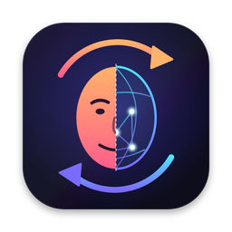

<p align="center"></p>

# FaceSwapMac

**Русский** · [English](README.en.md)

Нативное приложение для macOS, которое в реальном времени подменяет лицо на камере по одной фотографии. Обучать ничего не нужно: выбираешь фото, и лицо в кадре сразу заменяется. Работает на Mac с Apple Silicon, всё считается локально, в интернет ничего не уходит.

## Возможности

- Подмена лица с камеры по одной фотографии: можно выбрать файл или перетащить фото в окно
- Детектор лица на нативном Core ML (Neural Engine), вклейка лица на GPU через Metal
- Двухпоточный конвейер: пока обрабатывается текущий кадр, следующий уже готовится
- Сглаживание ключевых точек, зеркальное превью, выбор камеры (встроенная, USB, iPhone через Continuity Camera)
- Интерфейс на русском и английском
- Метка «AI · подмена лица» на превью, включена по умолчанию

## Установка

Требования: Mac на Apple Silicon (M1 и новее), macOS 14 Sonoma или новее, около 1 ГБ свободного места на диске, камера.

### Вариант 1. Готовое приложение (проще всего)

1. **Скачай приложение.** Открой страницу [Releases](https://github.com/daniil7890/faceswapmac/releases/latest) и скачай `FaceSwap-vX.Y.Z-arm64.zip`.
2. **Распакуй и перенеси в «Программы».** Дважды кликни по zip-архиву и перетащи `FaceSwap.app` в папку «Программы» (Applications).
3. **Сними карантин.** Приложение не подписано сертификатом Apple, поэтому macOS не даст открыть его двойным кликом. Открой «Терминал» и выполни:
   ```bash
   xattr -dr com.apple.quarantine /Applications/FaceSwap.app
   ```
   Другой способ: правый клик по приложению → «Открыть» → «Открыть». Если macOS всё равно ругается, зайди в «Системные настройки» → «Конфиденциальность и безопасность», пролистай вниз и нажми «Всё равно открыть».
4. **Скачай модели.** Это ~460 МБ, нужно один раз. В «Терминале» выполни:
   ```bash
   curl -fsSL https://raw.githubusercontent.com/daniil7890/faceswapmac/main/scripts/download_models.sh | bash
   ```
   Скрипт скачает три ONNX-модели и Core ML-детектор в `~/Library/Application Support/FaceSwapMac/models`. Если какой-то файл уже есть, скрипт его пропустит.
5. **Запусти FaceSwap** и разреши доступ к камере, когда macOS спросит.
6. **Подожди первую загрузку.** CoreML компилирует модели под твой Mac, это занимает до минуты. Следующие запуски быстрые.
7. **Выбери лицо.** Перетащи фото в левую панель или нажми «Выбрать фото…». Лучше всего подходит анфас: лицо крупно, хорошо освещено, глаза не закрыты очками или чёлкой.

### Вариант 2. Сборка из исходников

1. Поставь инструменты разработчика. Полный Xcode не нужен:
   ```bash
   xcode-select --install
   ```
2. Склонируй репозиторий, скачай модели и собери приложение:
   ```bash
   git clone https://github.com/daniil7890/faceswapmac.git
   cd faceswapmac
   bash scripts/download_models.sh
   bash scripts/make_app.sh
   open build/FaceSwap.app
   ```
   Первая сборка скачивает ONNX Runtime и занимает несколько минут. Если сборка упадёт, полный лог будет в `build.log`.

### Обновление

Скачай новую версию из [Releases](https://github.com/daniil7890/faceswapmac/releases/latest) и замени ею старую в «Программах». Потом повтори шаги 3 и 4: команду `xattr` и скачивание моделей. Скрипт докачает только то, что появилось в новой версии. Например, при переходе с 0.1.0 он скачает Core ML-детектор.

### Если что-то не работает

| Проблема | Что делать |
|---|---|
| «Приложение повреждено» или не открывается | Повтори шаг 3, команду `xattr` |
| «Нет файла модели …» | Повтори шаг 4. В `~/Library/Application Support/FaceSwapMac/models` должны быть три `.onnx` файла и папка `coreml` |
| Внизу панели написано «ONNX CPU», а не «Core ML» | Не скачан Core ML-детектор: повтори шаг 4. Приложение работает и так, только чуть медленнее |
| Чёрное превью или «Нет доступа к камере» | «Системные настройки» → «Конфиденциальность и безопасность» → «Камера» → включи FaceSwap |
| «На фото не найдено лицо» | Возьми другое фото: анфас, лицо крупнее, освещение лучше |
| Низкий fps | Подключи зарядку и закрой тяжёлые приложения. На MacBook Air fps ниже, чем на Pro и Max |

### Удаление

Удали `FaceSwap.app` из «Программ» и папку `~/Library/Application Support/FaceSwapMac`.

## Использование

- **Язык.** Переключатель «Русский / English» находится вверху боковой панели. При первом запуске язык берётся из системы.
- **Сглаживание.** Чем выше значение, тем стабильнее лицо, но тем сильнее оно отстаёт при быстрых движениях головы.
- **Строка внизу панели** показывает fps, время подмены одного кадра и, найдено ли лицо. Под ней написано, на чём работает приложение. Норма — «Core ML · Metal».

### Discord, OBS, Zoom

Своей виртуальной камеры пока нет: для Camera Extension нужна подпись Developer ID. Обходной путь через OBS: «Захват окна» → FaceSwap, потом «Запустить виртуальную камеру». В Discord или Zoom выбери камеру «OBS Virtual Camera».

## Как это работает

```
камера 720p ──► поток 1: детектор SCRFD (Core ML, ~0,7 мс) ─► 5 точек ─► выравнивание ─► вырезка 128×128
                                                                                              │
экран ◄── поток 2: вклейка лица с мягкой маской (Metal) ◄── inswapper_128 (ONNX + CoreML) ◄──┘
                                                                  ▲
фото ──► SCRFD 640 ─► ArcFace ─► «личность» (512 чисел) ───────────┘
```

- **Почему inswapper работает через ONNX Runtime, а не через нативный Core ML.** Замеры на MacBook Air: ONNX Runtime с CoreML-провайдером тратит на модель ~60 мс, лучший нативный вариант Core ML ~108 мс. Детектор, наоборот, на нативном Core ML ускорился с ~7 до ~0,7 мс. Поэтому схема гибридная.
- **Скорость.** Потолок задаёт inswapper, около 60 мс на кадр. На MacBook Air это ориентировочно до 15 fps, на Pro и Max fps выше.
- **Точность.** Предобработка (выравнивание, вырезка, маска, вклейка) написана на Swift и сверена с эталоном на Python. Модели Core ML проверены на совпадение с ONNX.

## Для разработчиков

### Структура

| Путь | Что там |
|---|---|
| `Sources/FaceSwapMac/App.swift` | SwiftUI-интерфейс, загрузка фото |
| `Camera.swift` | захват с камеры и двухпоточный конвейер |
| `Engine.swift` | этапы `prepare` (детекция и выравнивание) и `finish` (inswapper и вклейка), сглаживание точек |
| `CoreMLDetector.swift` | детектор на нативном Core ML, запасной вариант на ONNX |
| `MetalCompositor.swift` | вклейка лица на GPU (compute-шейдер) |
| `Models.swift` | обёртки ONNX Runtime, декодер SCRFD, чтение `emap` прямо из inswapper.onnx |
| `ImageOps.swift` | выравнивание по подобию, warp, маска, CPU-вклейка (запасной вариант) |
| `Localization.swift` | строки на русском и английском: `L("…", "…")` |
| `assets/` | иконка: `icon.svg` (исходник) и `AppIcon.icns` |
| `reference/` | эталон на Python и порт Swift-математики для сверки |
| `scripts/` | скачивание моделей, сборка `.app`, конвертация в Core ML и замер скорости |
| `.github/workflows/` | CI-сборка, выпуск релизов, публикация Core ML-моделей |

### Модели Core ML

`bash scripts/convert_coreml.sh` конвертирует модели в `.mlpackage`, сверяет их с ONNX и сравнивает скорость. `bash scripts/bench_coreml.sh` прогоняет inswapper отдельно на GPU, Neural Engine и CPU. Опубликованный Core ML-детектор собирает workflow `coreml-models` и выкладывает в релиз `models-coreml-v1`.

### Выпуск версии

1. Подними версию в `scripts/make_app.sh` (`CFBundleShortVersionString`) и обнови `.github/RELEASE_NOTES.md`.
2. Actions → `release` → Run workflow → укажи версию, например `v0.3.0`. Workflow соберёт приложение, создаст тег и релиз и прикрепит zip.

## Идеи на будущее

- Улучшайзер лица (GFPGAN/CodeFormer) через кадр
- Своя виртуальная камера через Camera Extension
- Режим «вся голова» с волосами (LivePortrait)
- Связка с [RVCMac](https://github.com/daniil7890/rvcmac): голос и лицо в одном приложении

## Ответственность и лицензии

Не выдавай себя за реального человека без его согласия. В большинстве стран это незаконно (мошенничество, клевета, законы о дипфейках), да и просто подло. Метка «AI» на превью включена по умолчанию.

Модели InsightFace (inswapper, ArcFace, SCRFD) распространяются по лицензии только для некоммерческого использования.
